  

  
  
  
  

## Sobre

Há **mais de 15 anos em qualidade de software**. Comecei em 2011 testando sistemas de varejo (Oracle EBS, Oracle Retail e JD Edwards) e hoje atuo como **QA Engineer SR** com foco em automação, *shift-left testing* e IA aplicada a testes.

## O que eu faço

<table>
  <tr>
    <td width="50%" valign="top">
      <h3>🧪 E2E web</h3>
      
Fluxos críticos de ponta a ponta com Playwright, Cypress e Robot Framework, escritos em BDD (Gherkin) e organizados em Page Objects.

      
<code>Playwright</code> <code>Cypress</code> <code>Cucumber</code> <code>Robot Framework</code> <code>TypeScript</code>

    </td>
    <td width="50%" valign="top">
      <h3>🔌 API</h3>
      
APIs REST validadas com testes automatizados em JavaScript e Python, de integração e de unidade, incluindo autenticação JWT.

      
<code>Postman</code> <code>Python</code> <code>Mocha</code> <code>Chai</code> <code>Supertest</code>

    </td>
  </tr>
  <tr>
    <td width="50%" valign="top">
      <h3>📱 Mobile</h3>
      
Automação de apps iOS e Android com Appium e WebdriverIO, em emulador no CI e em dispositivos na nuvem com BrowserStack.

      
<code>Appium</code> <code>WebdriverIO</code> <code>BrowserStack</code> <code>Robot Framework</code>

    </td>
    <td width="50%" valign="top">
      <h3>⚡ Performance</h3>
      
Testes de carga com k6 e JMeter: rampas de usuários, limites de aceite (thresholds) e massa de dados gerada.

      
<code>k6</code> <code>JMeter</code> <code>Faker</code> <code>k6-reporter</code>

    </td>
  </tr>
</table>

## Stack

  
  
  
  
  
  
  
  
  
  
  
  
  
  
  
  
  
  
  
  
  

`WebdriverIO` · `Grafana` · `Kafka` · `Jira` · `Swagger` · `Supertest` · `Sinon` · `Express` · `JWT` · `Faker` · `Allure` · `Mochawesome` · `cucumber-html-reporter` · `Docker` · `Page Objects` · `Gherkin`

**IA no fluxo de QA**

  
  
  

## Projetos em destaque

<table>
  <tr>
    <td width="50%" valign="top">
      <h3>🧪 <a href="https://github.com/michelemezzaroba/cypress-pgats">cypress-pgats</a></h3>
      
Casos do Automation Exercise automatizados com Cypress, com relatórios Allure e Mochawesome publicados pelo GitHub Actions.

      
<code>Cypress</code> <code>Allure</code> <code>Mochawesome</code> <code>CI</code>

    </td>
    <td width="50%" valign="top">
      <h3>🥒 <a href="https://github.com/michelemezzaroba/cypress_outsera">cypress_outsera</a></h3>
      
Login e checkout do Sauce Demo em Gherkin, com Page Objects e testes de API na mesma suíte.

      
<code>Cypress</code> <code>Cucumber</code> <code>BDD</code> <code>API</code>

    </td>
  </tr>
  <tr>
    <td width="50%" valign="top">
      <h3>🔌 <a href="https://github.com/michelemezzaroba/task-api-pgats">task-api-pgats</a></h3>
      
API REST + GraphQL de tarefas com autenticação JWT e MongoDB, coberta por testes de integração e de unidade no CI.

      
<code>Node.js</code> <code>GraphQL</code> <code>Mocha</code> <code>Supertest</code>

    </td>
    <td width="50%" valign="top">
      <h3>⚡ <a href="https://github.com/michelemezzaroba/k6-pgats">k6-pgats</a></h3>
      
Teste de carga da Task API com rampas de usuários, thresholds e massa de dados gerada com Faker.

      
<code>k6</code> <code>Faker</code> <code>Performance</code>

    </td>
  </tr>
  <tr>
    <td width="50%" valign="top">
      <h3>📱 <a href="https://github.com/michelemezzaroba/appium">appium</a></h3>
      
Teste Android com Robot Framework + AppiumLibrary, executado em emulador no GitHub Actions.

      
<code>Appium</code> <code>Robot Framework</code> <code>Android</code>

    </td>
    <td width="50%" valign="top">
      <h3>🖥️ <a href="https://github.com/michelemezzaroba/anota_ai">anota_ai</a></h3>
      
Cardápio digital testado em desktop e mobile, com matriz de viewport no pipeline.

      
<code>Cypress</code> <code>Page Objects</code> <code>Responsivo</code>

    </td>
  </tr>
</table>

Mais projetos: <a href="https://github.com/michelemezzaroba/robot-framework-web">robot-framework-web</a> · <a href="https://github.com/michelemezzaroba/superfrete">superfrete</a> · <a href="https://github.com/michelemezzaroba/k6">k6</a> · <a href="https://github.com/michelemezzaroba/programacao-para-automacao-de-testes">programacao-para-automacao-de-testes</a>

## Como eu trabalho

- **Teste que roda no pipeline:** 7 dos meus projetos executam no GitHub Actions e deixam relatório ou artefato.
- **BDD como contrato:** cenários em Gherkin que o negócio consegue ler e validar.
- **Cobertura em camadas:** web, API, mobile e performance, cada uma com a ferramenta adequada.
- **Suíte fácil de manter:** Page Objects, comandos reutilizáveis e massa de dados gerada.
- **IA como par de revisão:** Claude, Codex e Gemini aceleram roteiros, análise de falhas e revisão de código; a decisão continua apoiada em teste e evidência.
- **Evidência acima de opinião:** Allure, Mochawesome e relatórios do k6 mostram o que passou e o que falhou.

🎓 Estudando para as certificações **CTFL** e **CTFL-AT** (ISTQB).
<!-- Atualize a linha acima se já concluiu alguma certificação. -->

  
  

